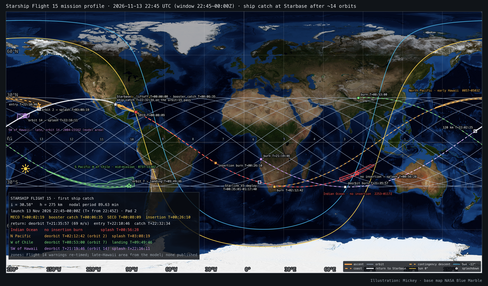

# Starship Flight 15 — mission profile model and interactive 3D page

Pre-launch model of **Starship Flight 15**, the first flight planned to return both stages to Starbase for a catch:
Super Heavy at T+06:35 and the ship at T+22:32:34 after about 14 orbits. Built from the official flight timeline and
mission description (spacex.com, 7 Nov 2026) on top of the Flight 14 model (orbit plane fitted to the September
navigational warnings, ship calibrated on Flight 14's reconstructed entry). Launch window 13 Nov 2026 22:45–00:00 UTC
(16:45–18:00 CST), Pad 2. **A model from public information, not telemetry and not an official ephemeris.**



**Interactive page:** https://exoplanet5.github.io/Starship-FLT15/ (or serve `docs/` locally with `python3 tools/serve.py`,
then http://127.0.0.1:8770/). The page is a build of the launch-page template with five selectable missions: the nominal
return and the four ocean contingencies.

## What is here

| path | content |
|---|---|
| `docs/` | 3D page: ascent, Super Heavy return (its own moving marker), 14 orbits, reentry and catch; the contingency descents as dashed tracks; hazard areas with windows; launch-time slider across the window; MET playback; sky charts for any city or clicked point; synthetic TLE |
| `flt15_mission_map.png`, `flt15_mission_map_pacific.png` | global map (Greenwich-centred and Pacific-centred on 150°W): ground track, hazard areas, every burn, entry and landing point of the five profiles |
| `flt15_catch_approach.png` | the return over the Pacific, northern Mexico and south Texas, with 2-minute marks (height, Mach) and an inset of the final approach to the tower |
| `flt15_tle.txt` | SGP4 TLE fitted to the model orbit for a 22:45Z launch (placeholder 99995, not observed) |
| `flight-timeline.txt` | official Flight 15 timeline |
| `navwarning/` | the Flight 14 warning polygons used as Flight 15's hazard areas, with a note |
| `export/` | mission JSON files as written by `work/flt15_export.py` (copied into `docs/data/` by the template's `new_page.py`) |
| `work/` | Python: orbit and ascent (`flt15_orbit.py`), descents (`flt15_descents.py`), zones, TLE, maps, export |

## The mission, from the official timeline

Liftoff; Max Q T+0:58; MECO T+2:19; hot staging T+2:21; boostback T+2:26–3:02; Super Heavy landing burn T+6:10 and
catch T+6:35; SECO T+8:09 onto a passively safe suborbital path; orbit insertion burn T+26:10–26:30 (one sea-level
Raptor); 26 Starlink V3 deployed T+35:01–1:17:40; Early Hawaii Return Check T+1:27:46; Mid Chile Return Check
T+7:15:35; Final Hawaii Return Check T+20:41:55; deorbit burn T+21:35:57–21:36:07; entry T+22:10:46; transonic
T+22:29:34; subsonic T+22:30:13; landing burn T+22:32:16, flip T+22:32:18, 3→2→1 engines, catch T+22:32:34.
SpaceX: ~275 km orbit, about 14 orbits, more than 22 h; reentry over the Pacific thousands of km uprange, a series of
small turns over sparsely populated northern Mexico and south Texas, around the Rio Grande Valley cities, north of
South Padre Island, out over the Gulf and a final turn south to the Pad 2 tower; early- and late-mission splashdown
options around Hawaii and a mid-mission option off Chile, the precleared areas used on Flight 14.

## Model

**Orbit plane.** Flight 14's fit to the September 2026 warnings (`~/sda/starship-ITF-14`): i = 30.58°, 275 km circular
with J2 secular rates, node 2.1° east of the pad, the ascent steering into the plane. SpaceX says Flight 15 flies the
same altitude and inclination. One free parameter was added: the orbital rate is scaled by +0.00134 (nodal period
89.63 min instead of 89.75, the same as a 269 km mean orbit), solved together with the deorbit Δv and bank so that
the modeled catch happens at the official T+22:32:34. It absorbs the assumed SECO downrange (15°), the mean altitude
(Flight 14's deorbit telemetry read 270 km against that model's 275) and the Flight 15 ascent differences. With it,
the modeled landing burn and catch match the official times to the second and transonic within 25 s.

**Why the return works.** The ground track shifts 22.9° west per orbit; on the 15th pass after insertion the orbit
crosses Starbase's longitude at 29.6°N, about 400 km north of the pad, having crossed the Kauai Channel at about 80 km.
The ship banks ~20° south through the glide to reach the tower, exactly as Flight 14's reconstructed entry reached a
splashdown 395 km south of its track.

**Ascent.** The Flight 14 ground path (cubic Hermite, pad at rest to the SECO state) re-timed along its arc length with
a shaped distance profile through telemetry-like anchors (Max Q 11.5 km at T+0:58, MECO 66 km and 1.5 km/s at T+2:19,
SECO 150 km, 15° downrange, 7.2 km/s ground speed at T+8:09) and a height profile ending on the coast ellipse in
height and climb rate (perigee −74 km, e 0.027, apogee 275 km 18.0 min after SECO). Insertion is modeled at the
burn start as an instantaneous circularisation.

**Super Heavy.** 2-D point mass from the MECO state: coast, 36 s boostback at 46 m/s² (1.66 km/s), ballistic fall
with US76 drag (ballistic coefficient 3400 kg/m²), 25 s landing burn to rest on the tower, arriving from the Gulf.
Apogee 102 km at T+3:42, 81 km maximum downrange, 630 m/s at the landing-burn start 4.5 km up and 2 km east of the
tower. Illustrative: throttles and the real descent profile are not public.

**Descents.** Flight 14's calibrated ship (3-DOF point mass, rotating WGS-84 Earth, J2, US Standard Atmosphere 1976,
modified-Newtonian belly-first aerodynamics, 55° hypersonic angle of attack, L/D 0.70, ballistic coefficient
331 kg/m², bank steering fading out below Mach 1.5), a 10 s one-Raptor deorbit burn, all started from the Flight 15
orbit state at the burn time.

| profile | deorbit burn | Δv, bank | 120 km | peak heating | max g | end |
|---|---|---|---|---|---|---|
| nominal, catch at Pad 2 | T+21:35:57 at 30.7°S 76.4°E | 69.2 m/s, 20.0° S | T+22:02:25 at 7.7°N 174.9°E | T+22:17:31, 72 km | 1.71 | catch T+22:32:34 |
| Indian Ocean, no insertion | — (coast from SECO, payload aboard) | 0, bank 81° reversed T+51:30 | T+45:58 at 29.1°S 58.8°E | T+51:03, 56 km | 5.24 | splash T+56:28 at 21.2°S 85.4°E |
| early Hawaii, orbit 2 | T+02:12:42 at 30.6°S 23.0°E | 71.0 m/s, 19.5° S | T+02:38:42 at 10.6°N 117.7°E | T+02:53:23, 72 km | 1.70 | splash T+03:08:19 at 25.50°N 155.43°W (Flight 14's point) |
| mid-mission Chile, orbit 7 | T+08:53:00 at 30.6°N 86.5°E | 71.2 m/s, lift up | T+09:18:56 at 4.4°S 175.6°W | T+09:33:46, 72 km | 1.64 | landing T+09:49:46 at 29.9°S 86.9°W (Flight 14's planned point) |
| late Hawaii, orbit 14 | T+21:19:46 at 11.7°S 12.9°E | 69 m/s (fixed), lift up | T+21:46:00 at 23.3°S 119.4°E | T+22:00:22, 72 km | 1.64 | splash T+22:16:11 at 18.3°N 165.5°W |

Nominal against the official timeline: 81 km at the official "entry" (Flight 14's reconstruction put that marker at
81–86 km), transonic T+22:29:59 vs 22:29:34, subsonic 22:30:12 vs 22:30:13, landing burn and catch exact. Closest
approaches of the nominal glide: Honolulu 49 km and Lihue 81 km at 79 km altitude; Hermosillo 40 km at 64 km;
Chihuahua 18 km at 61 km; Laredo 37 km at 49 km; Monterrey 183 km; Reynosa/McAllen 54 km at 42 km; Harlingen 15 km
at 39 km; Brownsville 30 km at 32 km; South Padre Island 9 km at 26 km. The constant bank is a model choice: SpaceX
describes small turns over sparsely populated areas, so the real corridor over Chihuahua and the Valley will differ.

**Final approach.** The last 180 km of the nominal ground path are re-shaped to SpaceX's description: over the
barrier island north of the South Padre Island town (26.19°N at 33 km altitude), out over the Gulf (apex 12 km
offshore at Mach 1.2), a final turn south-west to the tower, reached at 15 km altitude for the vertical belly flop.
Heights, speeds and times are the simulation's; the horizontal spacing is stretched 13 %.

**Late Hawaii.** On the 14th orbit, the same Pacific pass the return uses: the deorbit burn 16 min before the nominal
one (after the Final Hawaii Return Check at T+20:41:55), a Flight 14-like 69 m/s burn with the lift vector up, and a
splashdown 870 km south-west of Honolulu, short of the islands, at T+22:16:11. The entry coast crosses Western
Australia at 120 km and the glide passes Papua New Guinea near 90 km, as Flight 14's early return crossed the
Philippines; peak heating is over the open Pacific. The splashdown area drawn is a model box, not a published warning.
A glide shortened to the Flight 14 North Pacific area beyond the islands was tested and rejected (130° bank, 37 g).

## Hazard areas and windows

The polygons are Flight 14's warnings (NAVAREA IV 922/26 launch areas A and B, HYDROPAC 2751/26 Indian Ocean,
NAVAREA XII 657/26 = HYDROPAC 2761/26 North Pacific, HYDROPAC 2750/26 west of Chile). No Flight 15 warnings had
been published on 8 Nov 2026. The windows below are the Flight 14 windows re-timed to the Flight 15 launch window
(offsets from the window open and close kept); the late-Hawaii window is from the model. **They are not published values.**

| area | Flight 14 window | Flight 15 (re-timed) | model use |
|---|---|---|---|
| launch A, B (Gulf, Yucatán Channel) | 1215–1414Z | 2245–0044Z | ascent |
| Indian Ocean | 1223–1447Z | 2253–0117Z | no-insertion contingency, splash T+56:28 |
| North Pacific | 1427–1833Z | 0057–0503Z | early Hawaii, orbit 2, splash T+3:08:19 |
| West of Chile | 2107–0108Z | 0737–1138Z | mid-mission, orbit 7, landing T+9:49:46 |
| SW of Hawaii, late (model box) | — | see page | late Hawaii, orbit 14, splash T+22:16:11 |

## The page

`docs/` is a build of the launch-page template. Mission selector: nominal return, Indian Ocean, early Hawaii, Chile,
late Hawaii. The ship is drawn with the Flight 14 Starship cartoon (nose cone, heat-shield side, flaps; it glints when
sunlit), the booster as a plain stage with its own moving marker (template field `meta.companion`); the flight ends
with a descent (`meta.orbit_end_met`); all three were added to the template for this mission. Vehicle status, hazard-area
table (impact times only for the profile shown), timeline with official and model events, synthetic TLE for the
chosen T0, sky chart from any city or clicked point (home: South Padre Island), terminators, city lights, borders.
URL state: `?profile=starship-275&mission=flt15-rtls&t0=22:45:00&met=81000&cam=-97.2,26,1.1`.

## Limitations

- The plane, altitude and insertion state come from Flight 14; Flight 15's own warnings and any orbit change will
  move every zone crossing and the return pass. The period scale is a fit to one official time, not a measurement.
- The ascent and Super Heavy profiles are shaped, not flown: they are consistent at their ends (pad, MECO state,
  SECO state, tower) and plausible in between.
- The descents reuse one calibrated vehicle and constant-bank steering; SpaceX's guidance varies the bank, and the real
  corridor over land will differ by tens of km. Overflight distances are indicative.
- Sunlight is geometric (DE440s, WGS-84); plume visibility, weather and extinction are not modeled.
- The page's performance was checked on this Mac's GPU and on software GL only, at phone screen size for phones.

## Rebuild

```sh
P=~/.venvs/astro313/bin/python
$P work/flt15_orbit.py                 # orbit, ascent, booster report
$P work/flt15_descents.py --solve      # five descents (about 10 min); period scale written to work/phase.json
$P work/flt15_tle.py                   # TLE (after the descents, it uses the period scale)
$P work/flt15_map.py                   # the two maps
$P work/flt15_export.py                # export/*.json
SK=~/.claude/skills/launch-page/scripts
rm -rf docs && $P $SK/new_page.py . --mission export/flt15-rtls.json --id flt15-rtls --label "Flight 15 · ship catch at Starbase" \
   --profile starship-275 --profile-label "Starship · 275 km · 30.6°" --family low-inclination --title "Starship Flight 15 · ship catch at Starbase"
# then new_page.py --add for flt15-indian, flt15-hawaii-early, flt15-chile, flt15-hawaii-late (labels in work/CLAUDE notes)
$P $SK/check_page.py . --quick
```

## Credits

Illustration: Mickey. Base map: NASA Blue Marble Next Generation and Black Marble (public domain). Page: launch-page
template (three.js, MIT; star data d3-celestial, BSD-3; see the licence files in `docs/`). Flight 14 model:
github.com/exoplanet5/Starship-IFT14. Timeline and mission description: spacex.com. Code: MIT, see `LICENSE`.
